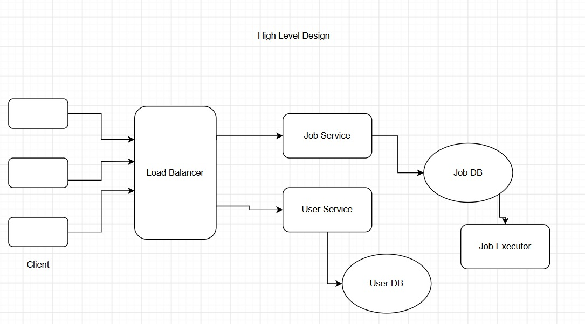
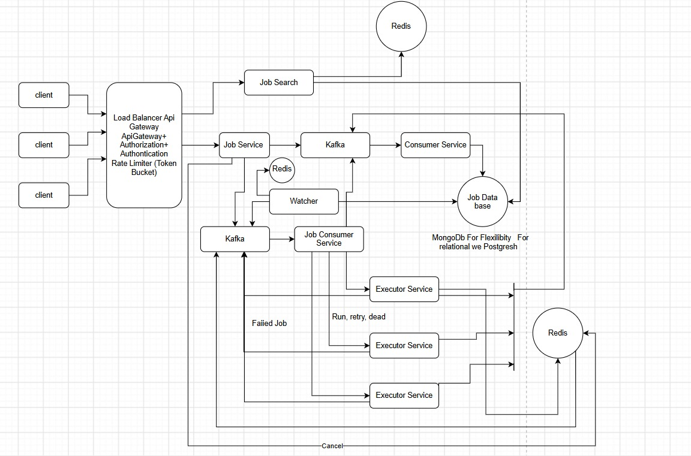

# 🚀 Distributed Trip Job Scheduler

### A Distributed, Multi-Tenant Job Scheduling System

**Java 21 | Spring Boot | PostgreSQL | Redis | Apache Kafka | Next.js**

A distributed job scheduling system designed to explore reliable job execution, horizontal scalability, fault tolerance, tenant isolation, and distributed coordination.

Built as an implementation of **MoveInSync – Case Study 3**.

---

## 🎬 Project Demo

<p align="center">
  <a href="https://youtu.be/yWJ7IUyE9Os">
    
  </a>
</p>

<p align="center">
  <b>▶ Click the thumbnail above to watch the complete project demonstration.</b>
</p>

---

## 🏗️ Architecture & System Design

The system separates durable job storage, distributed coordination, event delivery, and execution responsibilities to support reliable scheduling across multiple application instances.

### High-Level Architecture

<p align="center">
  
</p>

### Low-Level Design

<p align="center">
  
</p>

For detailed architectural decisions, design considerations, and implementation notes, refer to **[DESIGN.md](./docs/DESIGN.md)**.

---

## ✨ Key Features

| Feature | Description |
|---|---|
| Distributed Scheduling | Multiple application nodes coordinate job execution through partition ownership. |
| Multi-Tenant Architecture | Tenant-level isolation for users, jobs, and executions. |
| Idempotent Execution | Deterministic idempotency keys prevent duplicate run records. |
| Distributed Coordination | Redis-based partition lease coordination and fencing token primitives. |
| Transactional Outbox | Addresses the database-write and Kafka-publish dual-write problem. |
| Event-Driven Architecture | Kafka transports job execution events. |
| Fault Tolerance | Designed to handle node failures and duplicate message delivery. |
| Cron Scheduling | Recurring jobs with timezone and DST policies. |
| Execution Tracking | Maintains job runs and execution states. |
| Observability | Prometheus metrics for monitoring system health and execution behaviour. |

---

## 🛠️ Technology Stack

| Layer | Technology |
|---|---|
| Programming Language | Java 21 |
| Backend Framework | Spring Boot |
| Frontend | Next.js |
| Database | PostgreSQL |
| Distributed Coordination | Redis |
| Event Streaming | Apache Kafka |
| Database Migration | Flyway |
| Monitoring | Prometheus |
| Build Tool | Maven |
| Containerization | Docker & Docker Compose |

---

## ⚙️ Distributed System Design

### 1. Durable Job Storage – PostgreSQL

PostgreSQL acts as the source of truth for:

- Scheduled jobs
- Job execution records
- Transactional outbox events

Database constraints and indexes support durable state management and execution deduplication.

### 2. Distributed Coordination – Redis

Redis is used for:

- Partition lease coordination
- Fencing token generation
- Scheduling indexes and hot-data caching

Lease ownership and fencing validation require a complete production-grade ownership protocol.

### 3. Event Streaming – Apache Kafka

Kafka transports job execution events between scheduling and execution components.

The system accepts **at-least-once message delivery**, meaning consumers must safely handle duplicate messages.

### 4. Transactional Outbox Pattern

The outbox pattern addresses the database-write and Kafka-publish dual-write problem.

Workflow:

1. Job state and outbox event are committed in the same database transaction.
2. An independent publisher reads pending outbox events.
3. Events are published to Kafka.
4. Successfully published records are marked accordingly.
5. Consumers deduplicate messages to handle duplicate delivery.

### 5. Idempotent Execution

Each scheduled occurrence receives a deterministic idempotency key:

```text
jobId:scheduledEpochMillis
```

The `job_runs.idempotency_key` unique constraint prevents multiple run records for the same scheduled occurrence.

**Important:** Exactly-once business effects require durable downstream idempotency and fencing validation at the actual side-effect destination. Kafka delivery guarantees and Redis leases alone do not provide end-to-end exactly-once execution.

---

## 📐 Complexity & Capacity Model

| Operation | Complexity |
|---|---|
| Job creation | O(1) average partition assignment |
| Database insertion | O(log N) indexed structures |
| Due-job scanning | O(log N + B) |
| Run deduplication | O(log R) |
| Partition ownership state | O(P) |
| Partition claim | O(1) per partition |
| Storage | O(J + R + O) |

Where:

- `J` = Total scheduled jobs
- `R` = Retained execution records
- `O` = Outbox events
- `P` = Number of scheduling partitions
- `B` = Batch size

### Target Capacity

The case-study target:

- 100,000 scheduled jobs
- Execution within a 10-minute window
- Three-node cluster

This represents an average of approximately **166.7 jobs per second**.

The target p99 scheduling lag is less than 2 seconds. This is a performance objective, not a verified benchmark result.

---

## 🔐 Reliability & Failure Handling

The architecture considers the following distributed-system failure scenarios:

- Application node crashes during execution.
- Duplicate Kafka event delivery.
- Outbox publisher crashes after Kafka acknowledgement.
- Stale scheduler attempts execution after losing its lease.
- Multiple nodes compete for partition ownership.
- Database and Kafka experience temporary unavailability.
- Cron schedules encounter daylight-saving transitions.

The design uses durable state, idempotency, leases, fencing, and recovery mechanisms to address these scenarios.

---

## 📅 Scheduling & Timezone Policy

The scheduler uses tenant-specific `ZoneId` rather than the server's default timezone.

DST handling policy:

- **Spring-forward gap:** Skip nonexistent local times and move to the next matching cron occurrence.
- **Fall-back overlap:** Execute one occurrence per local scheduled date, choosing the earlier offset.
- **Persistence:** Store the resolved `Instant` to avoid recalculating a different occurrence after restarts.

Explicit DST tests are required before enabling cron workloads across DST regions.

---

## ▶️ Getting Started

### Prerequisites

- Java 21
- Maven 3.9+
- Docker
- Docker Compose
- Node.js (for the frontend)

### 1. Clone the Repository

```bash
git clone https://github.com/aviralnull/Trip-Job-Scheduler.git
cd Trip-Job-Scheduler
```

### 2. Start Infrastructure

```bash
docker compose up -d
```

This starts:

- PostgreSQL
- Redis
- Kafka
- Prometheus

### 3. Run the Spring Boot Application

```bash
mvn spring-boot:run
```

### 4. Run the Frontend

```bash
cd frontend
npm install
npm run dev
```

### 5. Verify Application Health

```text
http://localhost:8080/actuator/health
```

### 6. Access Monitoring

| Service | URL |
|---|---|
| Application Health | http://localhost:8080/actuator/health |
| Prometheus Metrics | http://localhost:8080/actuator/prometheus |
| Prometheus UI | http://localhost:9090 |

---

## 🔌 API Examples

### Create a One-Time Job

```bash
curl -u demo:password \
  -X POST http://localhost:8080/api/v1/jobs \
  -H 'Content-Type: application/json' \
  -d '{
    "name": "pickup-alert",
    "type": "ONE_OFF",
    "payload": "{\"tripId\":\"trip-123\"}",
    "zoneId": "Asia/Kolkata",
    "fireAt": "2026-10-31T08:00:00Z",
    "priority": 10,
    "maxRuntimeSeconds": 30,
    "misfirePolicy": "FIRE_NOW"
  }'
```

### Create a Recurring Job

```json
{
  "name": "daily-roster",
  "type": "CRON",
  "cronExpression": "0 0 22 * * *",
  "payload": "{\"action\":\"generate-roster\"}",
  "zoneId": "Asia/Kolkata",
  "priority": 5,
  "maxRuntimeSeconds": 300,
  "misfirePolicy": "COALESCE"
}
```

> **Development security:** The current HTTP Basic configuration is a development placeholder. Configure a proper user store or JWT authentication before using the API. The example credentials are illustrative and must be configured locally.

---

## 📁 Project Structure

```text
Trip-Job-Scheduler/
│
├── docs/
│   ├── DESIGN.md
│   ├── LOAD_AND_FAILURE_TEST_PLAN.md
│   ├── Distributed Trip Scheduler Demo.png
│   ├── high_level.jpeg
│   └── low_level_job_scheduler.jpeg
│
├── frontend/
│
├── src/main/java/com/moveinsync/scheduler/
│   ├── api/
│   ├── config/
│   ├── domain/
│   ├── repository/
│   └── service/
│
├── src/main/resources/
│   ├── db/migration/
│   └── redis/
│
├── src/test/java/
│
├── monitoring/
├── docker-compose.yml
└── README.md
```

---

## 🚧 Implementation Status & Future Improvements

This repository provides a runnable foundation for the distributed scheduling architecture. The following advanced-track requirements still need completion and verification:

- [ ] Production-ready JWT authentication and tenant identity propagation.
- [ ] Atomic lease acquisition and renewal with owner identity and monotonically increasing fencing tokens.
- [ ] Fencing validation at the side-effect destination.
- [ ] Durable downstream idempotency.
- [ ] Per-tenant concurrency limits and fair dispatch.
- [ ] Exponential retry backoff with jitter.
- [ ] Dead-letter replay and manual job triggering.
- [ ] Next-fire preview and complete misfire handling.
- [ ] Multi-node partition rebalancing.
- [ ] Distributed clock monitoring and UTC-based due-time authority.
- [ ] Comprehensive Prometheus metrics.
- [ ] Load and failure testing for the 100k jobs / 10-minute target.
- [ ] Three-node failover, duplicate delivery, `kill -9`, and `SIGSTOP` testing.

Production-grade guarantees and the p99 target must not be claimed until the relevant implementation and tests are complete.

See **[LOAD_AND_FAILURE_TEST_PLAN.md](./docs/LOAD_AND_FAILURE_TEST_PLAN.md)** for planned validation scenarios.

---

## ⚖️ Engineering Trade-offs

| Decision | Trade-off |
|---|---|
| PostgreSQL as source of truth | Durable consistency over purely in-memory scheduling. |
| Redis for coordination | Fast ownership coordination, but requires correct fencing and lease protocols. |
| Kafka at-least-once delivery | Reliability with consumer-side deduplication. |
| Transactional Outbox | Consistent event publishing with additional dispatch latency. |
| Fixed 256 partitions | Simpler partitioning, but requires explicit rebalancing. |
| Single-broker Kafka in Compose | Convenient local development, not production availability. |

---

## 🎯 Project Objective

The objective is to design and implement a reliable distributed scheduling system that can coordinate multiple scheduler instances, isolate tenants, recover from failures, and execute scheduled jobs without producing duplicate business effects.

**Built with Java 21, Spring Boot, PostgreSQL, Redis, and Kafka.**

---

<p align="center">
  <b>⭐ If you find this project interesting, consider giving the repository a star!</b>
</p>
